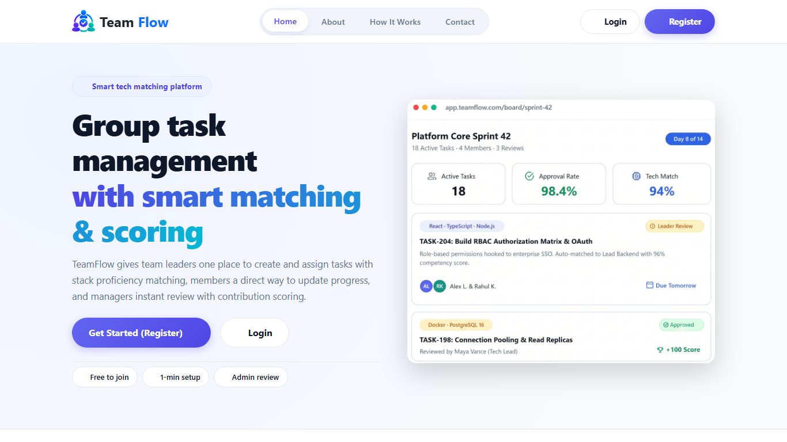
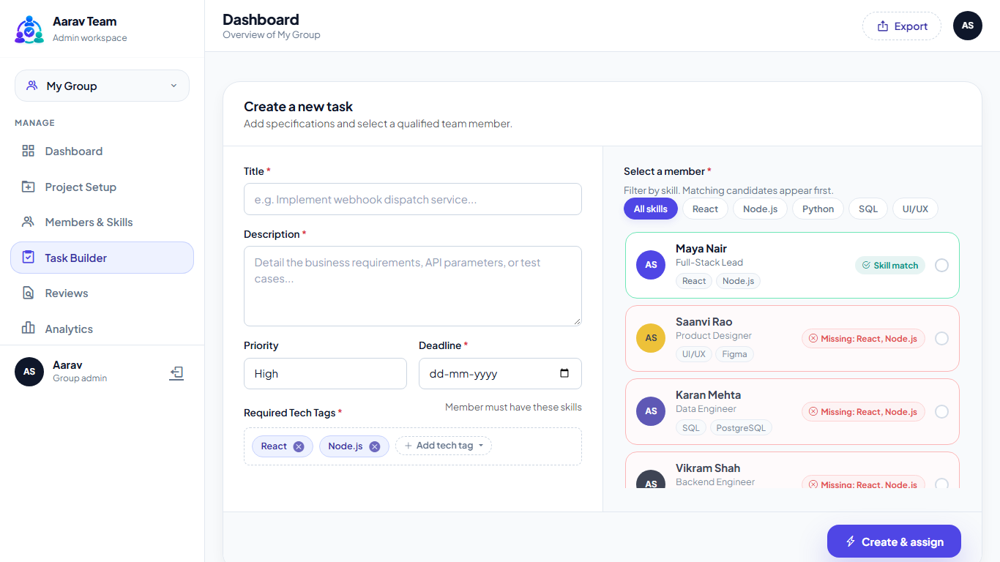
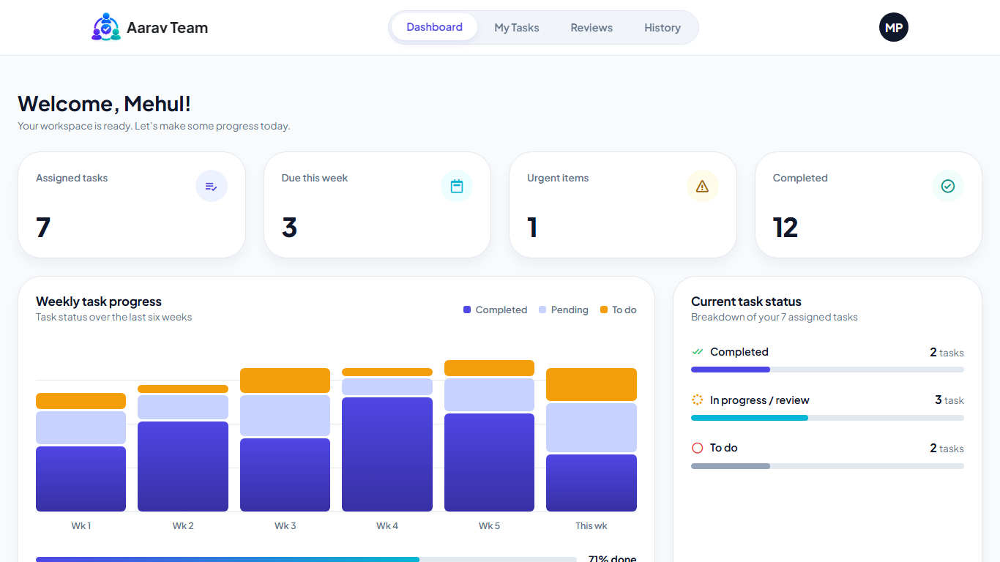
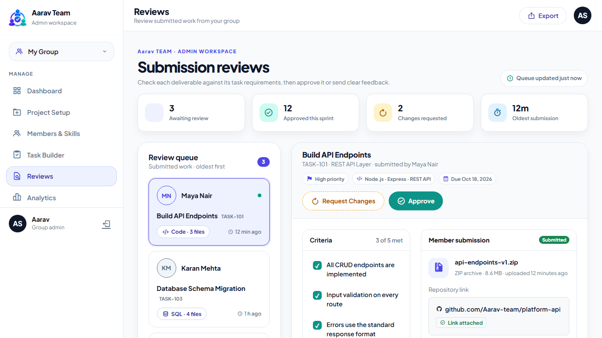

#  TeamFlow

> **A Modern Agile Sprint & Collaborative Task Management Platform**

---

## 📌 1. Overview

**TeamFlow** is an agile task management and collaboration platform built for college project teams, developer groups, and sprint planning. It connects **Project Leaders** and **Team Members** in a unified workspace to manage projects from initial planning to final delivery.

### What TeamFlow Does:
* **Project & Sprint Planning**: Organize project backlogs and track deadlines in one place.
* **Smart Task Assignment**: Automatically checks if a member has the required programming skills before assigning a task.
* **Deliverable Submissions**: Upload and store project archives (`.zip`, `.rar`, `.tar.gz`, `.pdf`).
* **Two-Way Code Reviews**: Leaders request specific changes, and members resubmit revised versions with changelogs.
* **Progress Tracking**: View weekly completion stats and export history reports as CSV.

---

## 👥 2. User Roles & Capabilities

TeamFlow provides two distinct workspaces tailored to each user's responsibilities:

| Feature | 👑 Project Leader (Admin) | 💻 Team Member |
| :--- | :---: | :---: |
| **Manage Projects** | Create, edit, and launch project portfolios | View active project details & roadmap |
| **Assign Tasks** | Create tasks & match to members by skill | View assigned tasks & target deadlines |
| **Submit Work** | Inspect submitted packages & notes | Upload deliverables (`.zip`, `.rar`, `.pdf`) |
| **Review & Approvals** | Request revisions or grant final approval | Read feedback & resubmit updated v2 |
| **Skill Profiles** | View member skill tags for smart allocation | Set & update personal skill proficiencies |
| **Analytics & Export** | View sprint velocity & download CSV reports | Export personal deliverable history |

### 👑 Project Leader (Admin)
* Create projects, set deadlines, and manage budgets.
* Assign tasks to the best-matching team members using **Skill Matching**.
* Review submitted code deliverables, request revisions with feedback, or approve work.
* Monitor sprint velocity and download performance reports as CSV.

### 💻 Team Member
* View assigned tasks and urgent deadlines on a personal dashboard.
* Start tasks and upload completed project archives.
* Read leader feedback on requested changes and submit revised work (v2) with changelogs.
* Update profile details and technical skill levels (Frontend, Backend, Design).

---

## 💻 3. Technology Stack

* HTML
* CSS
* Bootstrap
* JS
* Boxicions

---

## ✨ 4. Key Features

* **Intelligent Skill Matching**: When creating a task with tech tags (e.g. *React*, *Node.js*), the system automatically flags matching vs. mismatched candidates.
* **Deliverable Upload System**: Drag-and-drop or select archives with file size calculation and format validation.
* **Structured Revision Pipeline**: Members submit initial work (v1), leaders provide line-item feedback, and members resubmit updated packages (v2) with a changelog.
* **Real-time LocalStorage Persistence**: Task statuses, review decisions, submissions, and profile changes save automatically and persist across browser reloads.
* **Live Form Validation & Toasts**: Real-time feedback (`is-valid` / `is-invalid`), character counters, and animated toast notifications.

---

## 📷 5. Screenshots

### 1. Landing & Home Showcase
A responsive landing page presenting platform features, sprint workflow steps, and quick login links.

---

### 2. Leader Workspace — Task Assignment & Skill Matching
The administrative board where leaders create tasks, set required tech tags, and match tasks to the best candidates.

---

### 3. Member Workspace — Personal Dashboard
A developer dashboard with weekly completion charts, urgent action items, and task status cards.

---

### 4. Review & Approval Pipeline
Review board showing submitted archives, leader feedback notes, revision requests, and one-click approvals.

---